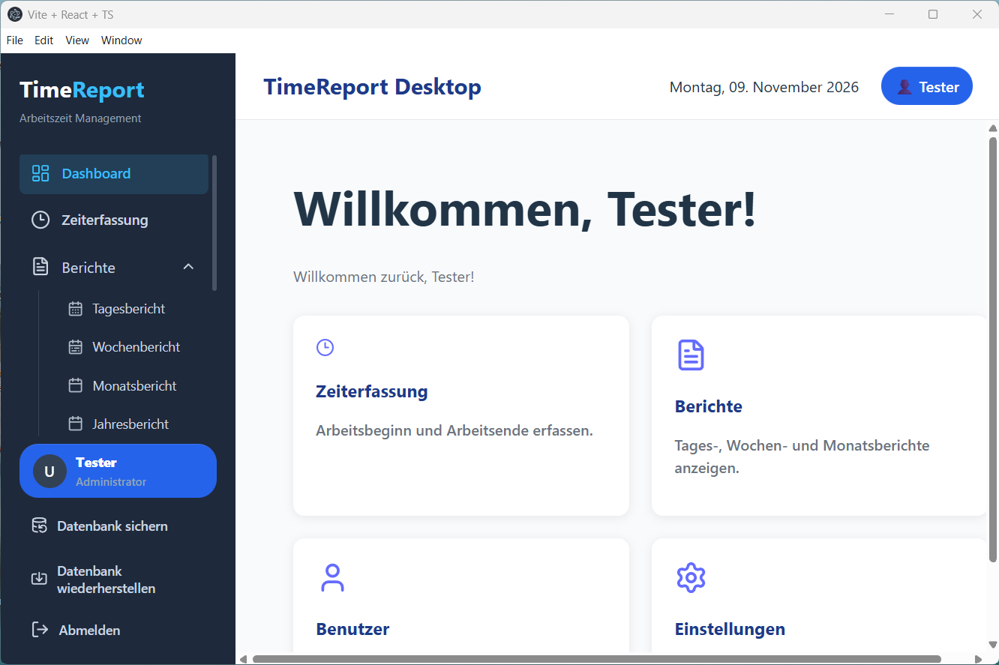
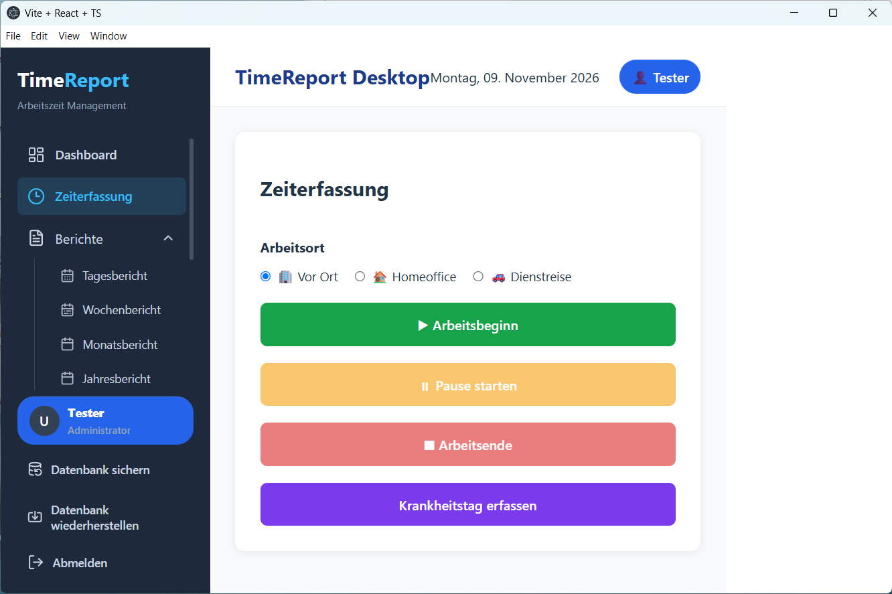
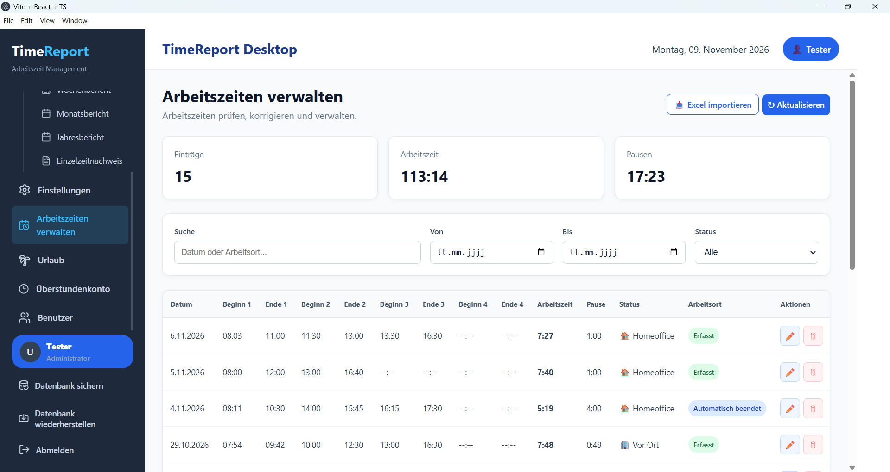
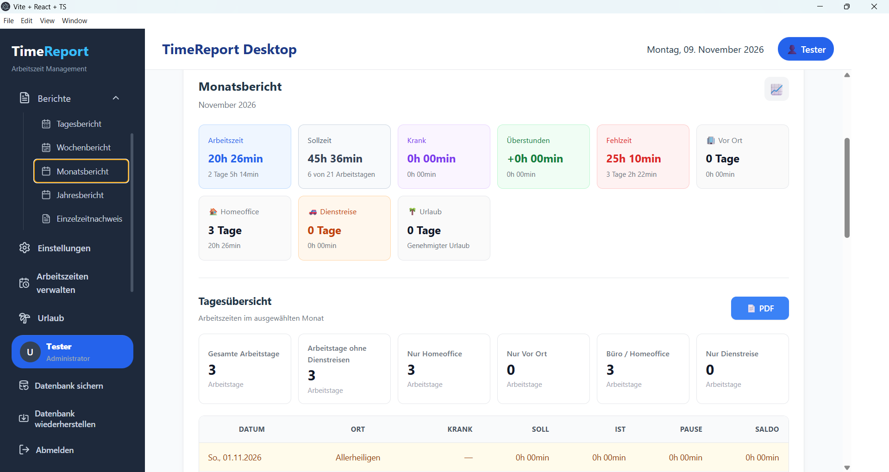

# 🚀 TimeReport-Desktop

Professional Time Tracking, Reporting & Productivity Management

A modern desktop application for professional time tracking, reporting, and productivity management.

Built with React, TypeScript, Electron, and SQLite.

Developed with AI-assisted support.

## Overview

TimeReport-Desktop is a desktop software project designed to provide a structured and efficient approach to time tracking, reporting, and productivity management.

The application combines a modern frontend with a desktop runtime and a local SQLite database.

## Features

Professional desktop application

Time tracking and management

Reporting and productivity overview

Local database powered by SQLite

Modern user interface built with React

Type-safe application development with TypeScript

Note: Adjust this list to match the features currently implemented in the application.

## 🛠️ Technology Stack

Technology

Purpose

React

User Interface

TypeScript

Application Development

Electron

Desktop Runtime

SQLite

Local Database

### 📊 Dashboard

### ⏱️ Time Tracking

### 📅 Work Management

### 📈 Reports & Analytics

### ⚙️ Settings

